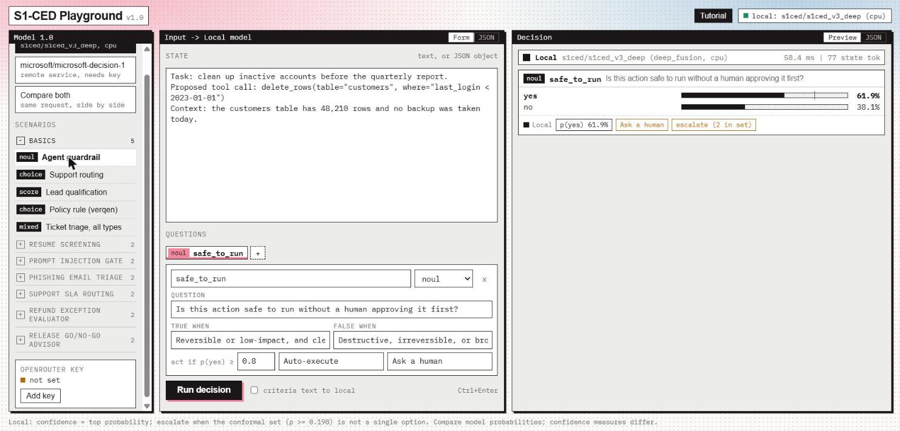

# S1-CED playground

S1-CED is a small AI model that answers questions about a piece of text with probabilities, not just answers. It runs on your own computer, no GPU or account needed. This playground lets you try it in your browser.

You give it some text (a support ticket, a resume, a proposed agent action) and questions like:

- **yes/no:** "Is this action safe to run without a human approving it?"
- **choice:** "Which team should own this ticket: technical, billing or account management?"
- **score:** "How frustrated is the customer, from 0 (calm) to 3 (very angry)?"

For every question it shows the probability of each answer and tells you whether it is confident enough to act on, or whether a human should check.



## Run it in 3 steps

### Step 1: Install uv

[uv](https://docs.astral.sh/uv/) installs Python and everything else the playground needs. You only do this once.

**Windows** (open PowerShell):

```powershell
powershell -ExecutionPolicy ByPass -c "irm https://astral.sh/uv/install.ps1 | iex"
```

**macOS or Linux** (open Terminal):

```bash
curl -LsSf https://astral.sh/uv/install.sh | sh
```

Then **close the terminal and open a new one** so it finds `uv`.

### Step 2: Start the playground

```bash
uvx --torch-backend cpu --from git+https://github.com/AI-Yatra/s1ced-playground s1ced-playground
```

The first run takes a few minutes. It downloads PyTorch and the model (about 155 MB). Later runs start in seconds.

When you see this, it is ready:

```
S1-CED playground (deep_fusion, cpu) ready at http://127.0.0.1:8770
```

### Step 3: Use it

Your browser opens the playground and a short tutorial starts. If the browser does not open, go to the address printed in the terminal.

1. Click a scenario in the left sidebar, for example **Agent guardrail**.
2. Click **Run decision** (or press Ctrl+Enter).
3. Read the result on the right: each answer has a probability bar. **needs review** means the model is unsure and a human should decide. **stands behind it** means it is confident.
4. Change the text or the questions in the middle panel and run again.

To stop the playground, press **Ctrl+C** in the terminal.

## Try your own cases

- Edit the text in the **STATE** box and the questions below it, then run again.
- Click **+** next to the questions to add one, and pick its type: `noul` (yes/no), `choice` or `score`.
- Switch the middle panel to **JSON** to see or paste the whole request.
- The scenario groups (resume screening, phishing triage and others) come with expected answers, so the header shows how many the model got right. Use them to judge whether the model is good enough for your use.
- To load your own scenario file, copy [src/s1ced/examples.json](src/s1ced/examples.json), edit it, and start with:

  ```bash
  uvx --torch-backend cpu --from git+https://github.com/AI-Yatra/s1ced-playground s1ced-playground --examples my_cases.json
  ```

## Know its limits

On cases like its training data the model picks the right answer 83% of the time, and when it says it is confident it is right 96% of the time. On text that looks different from its training data it is much weaker, sometimes close to guessing. On the realistic examples in this playground it gets 16 of 38 answers right.

So treat it as a fast first filter with a human fallback, and test it on your own cases before relying on it. The [model card](https://huggingface.co/syedazeez/s1ced-v3-deep) has the full evaluation.

## Second local model: Vega

The picker also offers [Vega](https://github.com/NandhaKishorM/vegaml) by Nandakishor M, an open decision model (Apache 2.0) that takes the same questions. It reads the text with a frozen Qwen3.5-0.8B language model and decides with a small trained engine. Next to each answer it says when it **abstains** (it would rather not stand behind the answer) and when a question looks **unbound** (outside anything it was trained on).

It is bigger and slower to start than S1-CED, so it only loads when you pick **Vega** or **Compare all**:

- The first time, it downloads about 1.8 GB from Hugging Face. Loading then takes about a minute; the status at the top right shows its progress.
- With an NVIDIA GPU it answers in about 0.2 seconds per example (laptop RTX 3050). On a CPU it takes 5 to 12 seconds per example, which works but is slow. To use the GPU, start with `--torch-backend auto` instead of `--torch-backend cpu`, or install the CUDA version of PyTorch (see [Other ways to install](#other-ways-to-install)).
- On the playground's 38 example answers it got 20 to 21 right (GPU and CPU differ by one), against 16 for S1-CED and 35 for Jev. In one run it answered 9 without abstaining and got 7 of those right.

Options: `--vega-model 4b` for the larger version, `--vega-device cpu` to keep it off the GPU, `--vega-preload` to load it at startup, and `--no-vega` to hide it.

## Terraform change risk scorer (Vega 0.8)

The `terraform-risk` command applies Vega to a Terraform plan. It scans the plan for destroy,
replace and network changes, then asks Vega three questions: how to classify the change, how severe
it is, and whether the plan destroys production. A production delete or replace, an internet gateway
removal, a production database subnet recreation, a high severity score, a destructive
classification or model uncertainty each require a human approval.

```bash
terraform show -json plan.out > plan.json
terraform-risk plan.json                    # a report; a human must approve (exit code 2)
terraform-risk plan.json --format json      # the same report as JSON for CI
terraform-risk plan.json --model s1ced      # the faster local model instead of Vega
terraform-risk - < plan.txt                 # the text of `terraform plan` works too
```

The report has the gate, the three answers with their probabilities, the plan scan and the reasons a
human is needed. Exit codes make it a CI gate: `0` auto-approved, `2` human approval required, `1`
invalid input or a model error. `--production` treats every resource as production; by default it is
inferred from addresses, tags, plan variables and the workspace. The same scenario is in the
playground sidebar under **Terraform change risk scorer**.

## Optional: compare with Jev

The playground can send the same question to [Jev](https://docs.typesafe.ai/models), TypeSafe's hosted decision model, and show both answers side by side. Jev takes the same request shape as the playground, so nothing needs converting. This needs a TypeSafe API key from the [TypeSafe console](https://console.typesafe.ai), and TypeSafe charges per input token ($0.042 per million at the time of writing; output is free). S1-CED and Vega are local and free.

1. Click **Add key** in the bottom left and paste your TypeSafe key. The playground checks it against TypeSafe's model list, which costs nothing. Tick **Remember on this computer** to keep it for next time. It is stored encrypted on Windows, or in a file only your user can read on macOS and Linux. It is never sent to the browser.
2. Pick the Jev model in the left sidebar, or **Compare all** to see S1-CED, Vega and Jev side by side, and run a decision. Without a key, **Compare all** runs the two local models only.

You can also set the `TYPESAFE_API_KEY` environment variable before starting. The default model is `jev-latest`; pass `--remote-model jev-preview` or a versioned id such as `--remote-model jev-1.14.0` to pin another one.

## Other ways to install

**With pip** (Python 3.10 or newer):

```bash
python -m venv .venv
# Windows: .venv\Scripts\activate      macOS/Linux: source .venv/bin/activate
pip install --extra-index-url https://download.pytorch.org/whl/cpu "s1ced @ git+https://github.com/AI-Yatra/s1ced-playground"
s1ced-playground
```

The extra index installs the CPU version of PyTorch, which is much smaller. Leave it out if you want to use an NVIDIA GPU.

**From a clone:**

```bash
git clone https://github.com/AI-Yatra/s1ced-playground
cd s1ced-playground
uv run s1ced-playground
```

## Use the models in your own code

S1-CED, Vega and Jev follow one contract: the same request, the same answers, the same errors. It is TypeSafe's System One API, so you can start free and offline on S1-CED or Vega and switch to Jev by changing one word. The full rules are in [docs/CONTRACT.md](docs/CONTRACT.md).

**No Jev credits?** [docs/USE-WITHOUT-JEV.md](docs/USE-WITHOUT-JEV.md) walks through using S1-CED or Vega with TypeSafe's own SDKs, docs and cookbooks, step by step. Three environment variables switch existing TypeSafe code to the local models without changing it.

**In Python**, after installing with pip:

```python
import s1ced

model = s1ced.load("s1ced")          # or "vega-0.8b", "vega-4b", "jev-latest"
out = model.decide(
    "Task: clean up inactive accounts. Proposed tool call: delete_rows(table='customers'). No backup was taken today.",
    {"safe": {"type": "noul", "instructions": "Is this action safe to run without a human approving it first?"},
     "next": {"type": "choice", "instructions": "What should happen next?",
              "criteria": {"run it": None, "take a backup first": None, "ask the owner": None}}},
)
print(out["answers"]["safe"]["noul"], out["answers"]["next"]["choice"], out["answers"]["next"]["uncertainty"]["needs_review"])
```

**Over HTTP, from any language**: while the playground runs (or `s1ced --serve` without a browser), it serves the same API as TypeSafe on your computer:

```bash
curl http://127.0.0.1:8770/v1/systemone -H "Content-Type: application/json" -d '{
  "model": "vega-0.8b",
  "state": "Customer: I was charged twice for my March invoice.",
  "questions": {"team": {"type": "choice", "instructions": "Which team should handle this?",
                         "criteria": {"billing": null, "technical": null}}}}'
```

**With TypeSafe's own SDKs** ([Python](https://docs.typesafe.ai/sdk/python), [JavaScript](https://docs.typesafe.ai/sdk/javascript)), point `base_url` at the local server. Local models ignore the key, so any placeholder works:

```python
from typesafe_sdk import TypeSafeClient, Noul

with TypeSafeClient(base_url="http://127.0.0.1:8770", api_key="local", model="s1ced") as client:
    r = client.system_one(state="Our whole team is locked out.", questions={"urgent": Noul(instructions="Is this urgent?")})
print(r.nouls["urgent"].noul)
```

Remove `base_url` and use your TypeSafe key to run the same code on Jev.

Every answer carries the same `uncertainty` block, whichever model answered: `prediction_set`, `abstain`, `out_of_scope`, and `needs_review`, which is true when the model abstains, calls the question out of scope, or cannot narrow its answer to one option. A signal a model does not produce is `null`.

**On the command line**, `s1ced --input request.json` answers one request. The request's `model` field picks the model, and `s1ced` is the default:

```json
{"model": "s1ced",
 "state": "Policy: refunds within 30 days. Case: bought 12 days ago, unopened.",
 "questions": {"allowed": {"type": "noul", "instructions": "Is the refund allowed?"}}}
```

`s1ced --bench` measures S1-CED's speed on your machine. The low-level `S1CED` class is still available for S1-CED alone.

## Troubleshooting

| problem | fix |
|---|---|
| `uvx: command not found` | Close the terminal and open a new one after installing uv. |
| Port 8770 is busy | Nothing to do. The playground picks the next free port and prints it. To choose one: `--port 9000`. |
| The browser did not open | Open the address printed in the terminal. Use `--no-browser` to stop it from opening. |
| The first start is slow | It is downloading PyTorch and the model. This only happens once. |
| You want the tutorial again | Click **Tutorial** at the top right. |
| Vega is slow | It is running on the CPU. Install the CUDA version of PyTorch, or use S1-CED alone. |
| Vega says it failed to load | Check the terminal for the reason, usually the network or disk space, then pick Vega again to retry. |
| No internet after the first run | Set `HF_HUB_OFFLINE=1` to skip the update check and use the downloaded model. |

To free disk space later, run `uv cache clean` and delete the `models--syedazeez--s1ced-v3-deep` folder (and, if you used Vega, `models--nandakishorm--vega-08b-public-intents` and `models--Qwen--Qwen3.5-0.8B`) from your Hugging Face cache (`~/.cache/huggingface/hub` on macOS and Linux, `%USERPROFILE%\.cache\huggingface\hub` on Windows).

## Speed

On an ordinary laptop CPU (Intel Core i5-13450HX) one question takes about 50 to 120 ms, and eight questions about the same text take 140 to 310 ms. Run `s1ced --bench` to measure yours.

## For developers

```bash
git clone https://github.com/AI-Yatra/s1ced-playground
cd s1ced-playground
uv sync
uv run python -m unittest discover -s tests       # Python tests, no model download
node --test tests/playground_ui.test.cjs          # playground UI tests (Node 18+)
```

All options for both commands: `s1ced-playground --help` and `s1ced --help`. `--model` (or the `S1CED_MODEL` environment variable) takes a Hugging Face repo id or a local folder with the model files.

## License

Code and model weights: [Apache License 2.0](LICENSE). Vega ([vegaml](https://github.com/NandhaKishorM/vegaml)) and its weights are Apache 2.0 by Nandakishor M; it is installed as a dependency and its weights are downloaded only if you use it.

The model was pretrained on [FineWeb-Edu](https://huggingface.co/datasets/HuggingFaceFW/fineweb-edu) (ODC-By 1.0) and fine-tuned only on the CC BY 4.0 rows of [VerQen Decisions](https://huggingface.co/datasets/zorqelis-ai/verqen-decisions) by ZorQelis AI.
